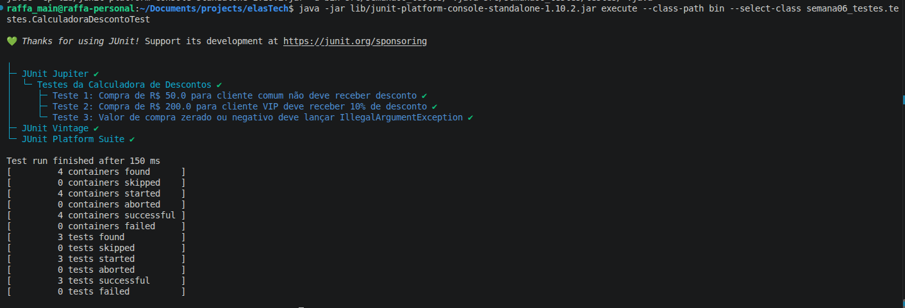

### Testes Unitários (JUnit 5 / TDD)

1. Cenário Real (Mudança na CalculadoraFrete)

B) O teste apita Vermelho imediatamente na máquina da programadora antes de o bug ir para o cliente (evitando regressão).

Justificativa: A principal função de uma suíte de testes unitários automatizados é a prevenção de regressão. Quando um desenvolvedor altera uma parte do código ou adiciona uma nova funcionalidade (como a entrega por Drone), os testes existentes rodam em segundos e notificam imediatamente se algo que funcionava previamente (como o cálculo do Sedex) foi quebrado.

2. Pirâmide de Testes

C) Porque eles testam pequenas partes isoladas do código, rodando em milissegundos e sendo muito mais baratos e fáceis de manter.

Justificativa: Na Pirâmide de Testes (Test Pyramid), a base é composta por testes unitários (~70%). Por não dependerem de rede, bancos de dados ou interfaces gráficas, eles executam em ordem de milissegundos, possuem baixo custo de execução e manutenção, e oferecem feedback instantâneo ao desenvolvedor.

3. Padrão AAA no JUnit 5

B) Usamos os comandos do JUnit (como assertEquals ou assertTrue) para verificar se o resultado obtido bateu com o esperado.

Justificativa: O padrão AAA divide o teste em três etapas distintas:

Arrange (Organizar): Preparação de instâncias, variáveis e cenários.

Act (Agir): Execução do método a ser testado.

Assert (Afirmar/Verificar): Validação dos resultados obtidos contra os valores esperados.

4. Teste de Exceções com JUnit 5

D) assertThrows(IllegalArgumentException.class, () -> conta.sacar(-50.0));

Justificativa: O método assertThrows do JUnit 5 recebe a classe da exceção esperada (ex: IllegalArgumentException.class) e uma expressão lambda contendo a execução da regra que deve disparar a falha.

5. Etapa "GREEN" no TDD

B) Escrever o código mais simples e direto possível na classe principal apenas para fazer o teste passar e ficar verde.

Justificativa: No TDD (Test-Driven Development), a etapa GREEN busca resolver a falha apontada pelo teste vermelho o mais rápido possível, escrevendo a implementação mínima necessária para que a afirmação seja satisfeita.

6.1. Por que o "teste no olho" com System.out.println() falha em projetos reais?

Não é automatizável: Em um projeto corporativo com milhares de métodos, é inviável rodar o sistema e conferir manualmente centenas de linhas impressas no console a cada alteração.

Impossibilidade de integração contínua (CI/CD): Servidores de automação (como GitHub Actions ou Jenkins) dependem de códigos de saída numéricos e assertions automatizadas para aprovar ou rejeitar uma compilação. O console não impede que um código quebrado vá para produção.

Falta de reprodutibilidade e isolamento: Testes manuais no main acumulam estado, exigem configuração prévia complexa e poluem a base de código com lógica de teste descartável.

Questão 6.2: Detetive de Código — Qual anotação foi esquecida?

Anotação Faltante: @Test (pertencente ao pacote org.junit.jupiter.api.Test).

Explicação: Sem a anotação @Test, a engine do JUnit 5 considera o método como uma função utilitária comum e ignora sua execução durante o ciclo de testes.

Questão 6.3: Refatoração sem Medo — Por que refatorar apenas após o teste ficar Verde?

Explicação: O estado Green (Verde) assegura que o comportamento funcional esperado foi atingido e que existe uma rede de segurança confiável. Ao refatorar após o verde, qualquer erro de lógica introduzido durante a limpeza do código fará o teste ficar Red (Vermelho) imediatamente. Refatorar no vermelho mistura a correção da regra de negócio com a reorganização estrutural, tornando o diagnóstico de erros extremamente complexo.

### Resumo dos Conceitos de Testes

```
       / \
      /   \     <- Testes End-to-End / E2E (Lentos, Caros, Poucos)
     /-----\
    /       \   <- Testes de Integração (Intermediários)
   /---------\
  /           \ <- Testes Unitários / Unidade (~70%, Rápida execução, Isolados)
 /_____________\
```


Ciclo do TDD (Red ➡️ Green ➡️ Refactor)

🔴 RED: Escreva um teste que falhe (pois a funcionalidade ainda não foi implementada).

🟢 GREEN: Escreva o menor código possível para fazer o teste passar.

🔵 REFACTOR: Melhore a estrutura do código (remova duplicações, melhore nomes, aplique padrões de projeto) sem alterar seu comportamento externo.

Padrão AAA

Arrange: CalculadoraDesconto calc = new CalculadoraDesconto();

Act: double resultado = calc.aplicarDesconto(100.0, true);

Assert: assertEquals(90.0, resultado);

